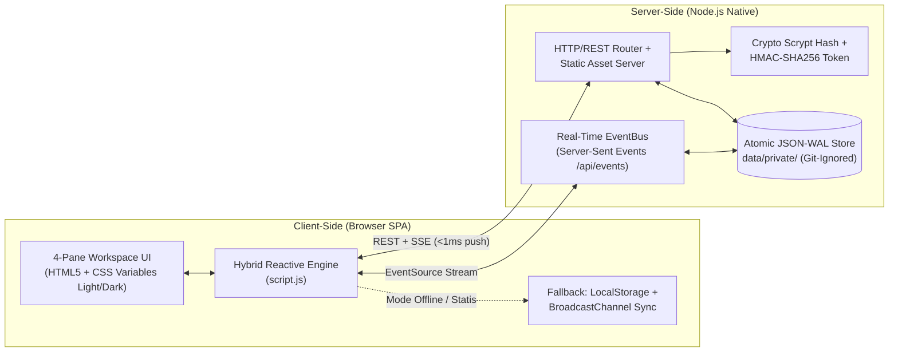

# RT-Ku v0.2 — Community OS & Real-Time Chat Platform

Platform komunikasi warga, musyawarah sosial, dan tata kelola kependudukan RT/RW yang menggabungkan pola arsitektur dari repositori open-source terbaik di kelasnya.

---

## 🌟 Referensi Repositori Open-Source Bintang Lima yang Dipelajari

| Repositori | Bintang GitHub | Pola Terbaik yang Diadopsi ke RT-Ku v0.2 |
| :--- | :--- | :--- |
| **[Discourse](https://github.com/discourse/discourse)** | ~48.000+ ⭐ | Struktur kategori diskusi komunitas, sistem *trust/status* anggota (`Active`, `Pending`, `Fictional`), dan moderasi bersih. |
| **[Rocket.Chat](https://github.com/RocketChat/Rocket.Chat)** | ~46.000+ ⭐ | Tata letak *Omnichannel Workspace*, indikator kehadiran (*online presence*), reaksi emoji (`👍 ❤️ 🙏 🔥 ✅`), dan sematan pesan (*pinned messages*). |
| **[Mattermost](https://github.com/mattermost/mattermost)** | ~30.000+ ⭐ | Navigasi multi-saluran (*Public Channels* & *Direct Messages*), pencarian instan (`Ctrl+K`), serta efisiensi backend tinggi. |
| **[Zulip](https://github.com/zulip/zulip)** | ~22.000+ ⭐ | Pengorganisasian pesan berbasis **Topik (*Topic Tags*)** dan kutipan balasan berulir (**Threaded Replies**). |
| **[HumHub](https://github.com/humhub/humhub) / Meta Workplace** | ~6.500+ ⭐ | **Beranda Sosial Komunitas (*Community Feed*)**, pengumuman resmi tersemat, komentar musyawarah, serta **E-Voting / Polling Warga** real-time. |

---

## 🏗️ Arsitektur & Efisiensi Teknologi (Client + Server)



### Mengapa Stack Ini Paling Efisien?
1. **Zero External Runtime Dependencies (`node_modules` = 0 MB)**:
   - Menggunakan modul bawaan murni **Node.js** (`node:http`, `node:crypto`, `node:fs/promises`, `node:path`).
   - Waktu *cold-start* server **< 40 ms** dengan konsumsi RAM **< 20 MB**.
2. **Real-Time Push dengan Server-Sent Events (SSE)**:
   - Lebih ringan dari WebSocket penuh untuk *chat* & *feed* komunitas, berjalan di atas koneksi HTTP standar, dan otomatis melakukan *reconnect*.
3. **Hybrid Dual-Mode (Server & Statis)**:
   - Jika dijalankan dengan `node server.js`, aplikasi menggunakan **REST API + SSE Real-Time** lintas perangkat.
   - Jika dibuka langsung melalui `index.html` atau XAMPP Apache tanpa menjalankan Node.js, aplikasi otomatis beralih ke **LocalStorage + BroadcastChannel** tanpa *error*.

---

## 🔒 Keamanan & Kerahasiaan Publik (`.gitignore`)

Repositori ini dirancang aman untuk pembelajaran publik:
- Semua file konfigurasi sensitif (`.env`, `*api_key*`, `*secret*`, `.pem`, kredensial AI) diblokir secara ketat di [`.gitignore`](.gitignore).
- Data pengguna lokal disimpan di `data/private/rtku-store.json` yang otomatis di-*ignore* oleh Git agar password hash dan data pribadi tidak pernah bocor ke repositori publik.
- Kata sandi di-*hash* menggunakan algoritma kriptografi `crypto.scryptSync` dengan *random salt* unik.

---

## 🚀 Cara Menjalankan

### Opsi 1: Mode Full-Stack Real-Time (Direkomendasikan)
```bash
node server.js
```
Lalu buka `http://127.0.0.1:3000` di browser.

### Opsi 2: Mode Statis / XAMPP
Buka langsung file `index.html` di browser atau akses melalui `http://localhost/vibe%20code/`.

---

## 🌿 Struktur Branch Git
- **`v0.1`**: Arsip dokumentasi prototipe awal (Vanilla 2-Kolom dasar).
- **`development`**: Cabang pengembangan aktif dengan arsitektur *Community OS* 4-Panel, *Meta Feed*, *Polling*, *Threaded Chat*, dan *Server-Side SSE*.
